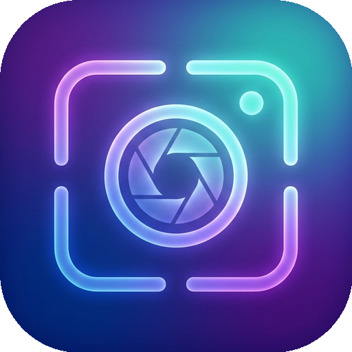

  
  <h1>AuraSnap</h1>
  
一款专为 Apple Silicon 打造的纯粹、优雅、原生 macOS 截图工作台，将截屏、原地无痕翻译、标注、贴图、OCR、长截图与背景美化发挥到极致。

  

    
    
    
    
  

  
🌐 <strong>官方网站 & 在线交互体验</strong>：<a href="https://aurasnap.dpdns.org/">https://aurasnap.dpdns.org/</a>

---

## ✨ 核心特性

AuraSnap 是一款从零构建的、完全基于 macOS 原生架构（Swift / AppKit / ScreenCaptureKit / Vision / Accelerate）的高性能效率工具。以“无感、轻量、高颜”为核心理念，常驻内存仅 ~45MB，提供一站式的截屏、原地翻译、贴图、标注、文字识别与背景美化体验。

### 🌐 空间无痕原地截图翻译 (In-Place Spatial Translation)
- **五域空间排版重构引擎**：截取外文网页、技术论文、报错弹窗或设计稿时，**直接在原图原地将外文替换为译文**，自动擦除原文底色，字体粗细、字号与色彩深度契合原图排版风格。
- **物理原位锚定与 CoreText 装箱度量**：告别机翻文字冲出框外的糟糕体验，基于 OCR 物理包围盒与射线借宽技术，自动自适应计算最佳行距与字号收敛，列表、代码与多栏排版严丝合缝。
- **双模翻译通道支持**：内置「快捷翻译」（开箱即用免配置），同时支持接入 Google、DeepL、微软 Azure、百度、腾讯、火山引擎等主流翻译服务。
- **贴图与右键一键重译**：贴图状态下直接按 `⌥ + T`、右键菜单点击「翻译」或点击底部工具栏即刻完成画面汉化，支持「重新翻译」强制刷新。

### 🎨 独立背景美化与系统壁纸
- **独立自适应美化窗口**：按下快捷键 `F` 或全局 `⌥7` 即可唤起独立美化工作台，支持 680pt 黄金宽度与图层隔离。
- **5K/Retina 系统壁纸**：支持一键接入当前屏幕真实桌面壁纸，自动扫描 `/System/Library/Desktop Pictures/` 官方 5K/6K HEIC 极清原图（Sequoia/Sonoma 等）。
- **智能主色提取与色板**：K-Means 聚类自动萃取截图 4 款画面主色调，提供「经典中性灰阶」、「莫兰迪低饱和色」、「Apple 经典硬件色」与原生拾色器。
- **3D 浮空光影与流式导出**：物理级高斯衰减阴影与 `CGImageDestination` 流式流盘，消除内存膨胀并防止边缘切边。
- **双向无损标注同步**：美化阶段支持无缝绘制箭头、文本与涂鸦，点击「返回截图」可秒级带着所有最新标注返回截屏。

### 🧹 智能内容擦除 (Content Eraser)
- **直方图背景主色分离**：色彩密度聚类算法自动剔除深色文字与边框噪点，确保白底与浅色背景 100% 洁白透亮。
- **PatchMatch 结构化纹理合成**：遭遇复杂微纹理、桌面材质或壁纸时，自动搜索最佳 $5\times 5$ 纯净图块进行克隆拼合。
- **多形态选区与秒级撤销**：支持 ▭ 矩形框选（默认）、⭘ 自由套索圈选 与 ✎ 画笔涂抹，松手立即消除画面且不留手柄，支持 `⌘Z` 纯值快照秒级撤销。

### 📌 沉浸式无限贴图与 ⌘ 拖拽外发
- **全局毫秒级唤醒**：后台静默运行，使用 `⌥ + 1` 瞬间触发截图，`⌘ + P` 一键固定为置顶贴图。
- **按住 `⌘` 直接拖拽外发与保存**：在贴图上按住 `Command` 键拖拽，直接拖入**微信、钉钉、飞书、Slack、邮件**发送，或拖入访达文件夹秒存为 PNG 文件。
- **无级等比缩放与未截断浮点时间线**：鼠标滚轮 / 触控板以光标为锚点 0.3x ~ 10.0x 平滑缩放，彻底消除整数像素截断漂移。
- **Ghost Mode 穿透模式**：按 `⌥ + G` 开启穿透，鼠标可直接穿透贴图去点击下方的代码或网页；长按 `Option` 可临时唤醒移动。
- **贴图时光机**：按 `⌥ + 2` 自动从后进先出栈恢复最近关闭的贴图窗口。

### 📝 强大的二次编辑标注与贴纸系统
- **10 大标注工具单键秒级直达**：按 `R`（矩形）、`A`（箭头）、`M`（马赛克）、`P`（画笔）、`L`（直线）、`T`（文本）、`N`（序号图钉）、`B`（双点引线批注）、`W`（水印）、`V`（选择），贴图浏览态下按单键自动进入编辑模式。
- **贴纸标注与物理双模等比缩放**：内置 Emoji、矢量图标、印章与自定义图片贴图，悬停轻扫触控板或滚轮即可等比平滑缩放。
- **区域均值像素化马赛克**：采用面积积分均值插值与点阵重采样，彻底根除文字抹除死白现象，保留报纸印刷级颗粒质感。
- **智能打字防冲突防线**：在文字标注或水印输入时，所有单键与热键 100% 绝对放行给系统输入，彻底杜绝打字误触。

### 🔍 独立 OCR 空间排版与全能文本清洗套件
- **Apple Neural Engine 硬件级加速**：中英日韩多语言混排 0.1~0.4s 秒级识别，超大 4K/5K 分辨率等比下采样防御与两阶段容灾降级。
- **阅读流空间几何重构**：翻转 Vision 坐标系为物理阅读流，自适应垂直聚类与水平列对齐，完美还原表格与多栏排版；一键生成幂等性 GFM Markdown 表格。
- **全域 CharCategory 文本清洗**：智能去空格（保留英文词距）、去换行（修复断行与连字符）、Pangu 智能间距、大小写与标点半角转换。
- **全模态拖拽与追加模式**：支持直接拖入外部图片即刻识别，开启「追加模式」多次截图自动保序换行拼接。

### 📜 双引擎长截图与 ⌘ 录屏外发
- **双引擎接缝融合长截图**：滑动窗口 DAG + Apple Accelerate 硬件级 2D DP 接缝切取（单帧 $<1.5\text{ms}$），快滑防截断，慢滑防重复，配有 Retina 2x Minimap 实时预览地图与 Shift 慢速微调模式。
- **三格式区域录屏与 ⌘ 拖拽外发**：支持 MP4 / 高清 GIF / WebM 录制；在循环播放器中**按住 `Command` 直接拖入聊天软件发送动图**或拖入文件夹保存；复制动图自动注入二进制数据流。

---

## 📦 下载与安装

由于 AuraSnap 尚处于公开测试阶段，暂未上架 Mac App Store，您可以直接在 GitHub Releases 获取：

1. 进入本项目仓库的 [**Releases**](https://github.com/8wcznkmy6b-del/AuraSnap-PB/releases) 页面。
2. 下载最新版本 **`v2.9.0`** 的 `AuraSnap.app.zip` 压缩包。
3. 双击解压，将解压出来的 `AuraSnap.app` 拖入系统的 **应用程序 (Applications)** 文件夹。
4. 首次运行根据系统提示授予**屏幕录制 (Screen Recording)** 与**辅助功能 (Accessibility)** 权限即可。

---

## ⚙️ 常用快捷键速查

| 功能 | 默认快捷键 | 说明 |
| :--- | :--- | :--- |
| **屏幕截图** | `⌥ + 1` (Option + 1) | 瞬间唤起屏幕截图与窗口微观吸附 |
| **恢复贴图** | `⌥ + 2` (Option + 2) | 从后进先出栈恢复上一张关闭的贴图 |
| **截图历史画廊** | `⌥ + 3` (Option + 3) | 打开带本地离线全文搜索的历史图库 |
| **文字识别 (OCR) 直达** | `⌥ + 4` (Option + 4) | 框选松手直接弹出多语言 OCR 结果窗口 |
| **长截图直达** | `⌥ + 5` (Option + 5) | 框选松手直接锁定选区并唤起长截图控制条 |
| **动图录制 (GIF) 直达** | `⌥ + 6` (Option + 6) | 框选松手直接锁定选区并唤起录屏栏 |
| **背景美化直达** | `⌥ + 7` (Option + 7) | 框选松手直接唤起 680pt 独立背景美化窗口 |
| **原地截图翻译 / 贴图翻译** | `⌥ + T` (Option + T) | 选区或贴图一键原地无痕翻译为目标语言 |
| **剪贴板转贴图** | `⌘ + ⌥ + T` | 复制纯文本/代码或外部图片一键生成浮空贴图 |
| **贴图穿透模式** | `⌥ + G` (Option + G) | 切换贴图鼠标点击穿透，长按 `⌥` 临时唤醒 |
| **标注单键直达** | `R` / `A` / `M` / `P` / `L` / `T` / `N` / `B` / `W` / `V` | 矩形/箭头/马赛克/画笔/直线/文本/序号/引线/水印/选择 |
| **内容擦除 / 贴纸 / 美化** | `D` (内容擦除) / `K` (贴纸) / `F` (背景美化) | 选区中单键直达新特性 |
| **选区转长截图 / 录屏 / 抠图 / 翻译** | `S` (长截图) / `G` (录屏) / `E` (抠图) / `T` (翻译) | 选区中单键直达进阶功能 |

> 所有快捷键均可在菜单栏「偏好设置」➔「快捷键」面板中通过智能录制器进行自定义修改。

---

## ☕ 赞助与支持 (Sponsor & Donate)

AuraSnap 是一款纯粹、无广告、完全免费的原生 macOS 生产力工具。如果您觉得 AuraSnap 对您的日常工作与学习有所帮助，欢迎请作者喝杯咖啡 ☕，您的支持是项目持续迭代与优化的最大动力！

  

  ⚡ 欢迎通过 <strong><a href="https://afdian.com/a/aurasnap" target="_blank">爱发电 (Afdian)</a></strong> 支持本项目：<a href="https://afdian.com/a/aurasnap" target="_blank">https://afdian.com/a/aurasnap</a>

  <table>
    <tr>
      <th align="center"><b>微信支付 (WeChat Pay)</b></th>
      <th align="center"><b>支付宝 (Alipay)</b></th>
    </tr>
    <tr>
      <td align="center">
        
      </td>
      <td align="center">
        
      </td>
    </tr>
  </table>

---

## 🛡 隐私与安全声明

AuraSnap 是一款 **100% 本地离线运行** 的原生应用，核心功能不依赖任何外部服务器。您的所有屏幕截图、历史记录、Vision 空间 OCR 文字识别与系统壁纸萃取均完全在 Mac 本地 Neural Engine 与 GPU 完成，充分保护您的数据隐私。

---

  AuraSnap - Snap your aura. 专为 Apple Silicon 深度优化。 
  🌐 官网：<a href="https://aurasnap.dpdns.org/">https://aurasnap.dpdns.org/</a>

