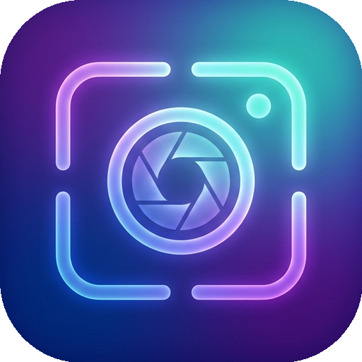

  
  <h1>AuraSnap</h1>
  
A native, ultra-lightweight screenshot toolkit for macOS & Apple Silicon.

  
Screenshots, In-Place Translation, Floating Pins, Scrolling Capture, OCR, Background Beautifier & Smart Erase.

  

    
    
    
    
  

  

    <a href="README.md"><b>简体中文</b></a> | <a href="README_EN.md"><b>English</b></a>
  

---

## 💡 Overview

AuraSnap is a native macOS screenshot and productivity tool built from the ground up in pure Swift. Free from Electron bloat, its background memory footprint stays below 40MB.

Beyond routine captures, annotations, and pinned overlays, AuraSnap focuses on frictionless workflows for reading foreign documentation, capturing full-length code/webpages, and creating polished social media-ready images.

---

## ✨ Features

### 🌐 Translation
* **In-Place Visual Rendering**: Select foreign text regions to erase background and render translated text directly on the original image. Automatically inherits baseline height, font weight/scale, and text color, preserving original paragraphs and multi-column layouts without app switching.
* **Multi-Provider & Quick Mode**: Includes a zero-configuration Quick Translation channel, alongside support for standard APIs including DeepL, Google Cloud Translation, Microsoft Azure, Baidu, Tencent, and Volcengine.
* **Instant Pin Translation**: Right-click on any floating pinned image or hit a hotkey to translate or re-translate immediately with side-by-side comparison.

### 📌 Interactive Floating Pins & Drag-and-Drop
* **Top-level Floating Overlays**: Pin screenshots, plain text, or clipboard images to stay on top. Zoom in/out smoothly using trackpad gestures or mouse scroll.
* **⌘-Drag to Export**: Hold the `Command` key and drag any pinned window directly into WeChat, Slack, Lark, DingTalk, Mail, or a Finder folder.
* **Ghost Mode (Click-Through)**: Make pinned images click-through so your mouse interacts with underlying code or browsers; hold `Option` to temporarily move it.

### 📜 Smooth Scrolling Capture (Long Screenshots)
* **Effortless Stitching**: Scroll freely to capture long chat threads, terminal outputs, and extended webpages, with a real-time minimap preview.

### 🔍 Offline Text Recognition (OCR)
* **Native Apple Vision Engine**: Multi-language recognition in milliseconds. Extract text directly from selections, captures, or dragged-in images.
* **Smart Layout & Markdown**: Recognizes paragraphs and tabular data. Copy directly as formatted Markdown tables with clean punctuation and spacing.

### 🎨 Background Beautifier & Mockups
* **Instant Social Media Cards**: Automatically extract dominant image colors into Morandi gradient backdrops, or use your current 5K system wallpaper as background.
* **Photorealistic macOS Shadow & Insets**: Customize window shadows, corner radius, and padding for professional tutorials and presentations.

### 🪟 Radial Window Manager
* **8-Direction Gesture Snapping**: Hold the middle wheel, mouse side button, or modifier key (`Fn`, `⌥`, `⌃⌥`) to summon a 160pt frosted glass radial menu. Fling in any of the 8 directions (half screens, 1/4 corners, maximize, center) to snap windows instantly.
* **Smart Complementary Tiling**: Automatically adjusts adjacent windows when minimum width constraints are met, eliminating window overlapping on smaller screens.
* **Stage Manager Padding & Window Gaps**: Smartly reserves sidebar room for Stage Manager thumbnails, with 0~24pt customizable gaps.

### 🖱️ Mouse & Cursor Enhancement
* **Trackpad-like Smooth Scrolling**: Converts stepped mechanical wheel ticks into buttery smooth inertial momentum scrolling.
* **Independent Reverse Scrolling**: Flip mouse wheel direction without affecting your trackpad's natural scroll settings.
* **Linear Pointer (Zero Acceleration)**: Removes macOS's non-linear mouse acceleration for 1:1 pixel-perfect tracking, ideal for Figma design and gaming.
* **Hardware Button Remapper**: Record mouse side buttons (Button 4/5) and middle click to trigger screenshots, pins, OCR, or radial window management.

---

## ⌨️ Shortcuts Reference

| Feature | Default Hotkey | Action |
| :--- | :--- | :--- |
| **Capture Screen** | `⌥ + 1` (Option + 1) | Trigger screenshot with smart window snapping |
| **Restore Last Pin** | `⌥ + 2` (Option + 2) | Reopen the most recently closed pinned window |
| **Screenshot Gallery** | `⌥ + 3` (Option + 3) | Browse local history with offline full-text search |
| **Instant OCR** | `⌥ + 4` (Option + 4) | Box select and immediately extract recognized text |
| **Scrolling Capture** | `⌥ + 5` (Option + 5) | Select area and enter scrolling capture mode |
| **Record GIF / MP4** | `⌥ + 6` (Option + 6) | Record animated GIF or video clip of selected area |
| **Background Beautifier** | `⌥ + 7` (Option + 7) | Open dedicated backdrop and frame editor |
| **In-Place Translation** | `⌥ + T` (Option + T) | Translate selected region or floating pin in-place |
| **Radial Window Manager** | Middle Click / Side Button / `Fn` / `⌥` Drag | Summon 8-direction radial wheel for instant window snapping |
| **Left / Right Split** | `⌃ + ⌥ + ←` / `→` | Snap active window to left / right half (50%) |
| **Top / Bottom Split** | `⌃ + ⌥ + ↑` / `↓` | Snap active window to top / bottom half (50%) |
| **Maximize / Center** | `⌃ + ⌥ + ↩` / `C` | Maximize window / center on current screen |
| **1/4 Screen Corners** | `⌃ + ⌥ + U` / `I` / `J` / `K` | Snap to Top-Left / Top-Right / Bottom-Left / Bottom-Right |
| **Clipboard to Pin** | `⌘ + ⌥ + T` | Create a pinned window from clipboard text or image |
| **Pin Click-Through** | `⌥ + G` (Option + G) | Toggle click-through mode; hold `⌥` to move |
| **Quick Annotation** | `R` (Rect) / `A` (Arrow) / `M` (Mosaic) / `P` (Pen) / `L` (Line) / `T` (Text) / `N` (Numbered) / `B` (Callout) / `W` (Watermark) | Single-key shortcuts to begin annotation immediately |

> All shortcuts can be customized in **Preferences** ➔ **Shortcuts**.

---

## 📥 Download & Installation

1. Visit the GitHub [**Releases**](https://github.com/8wcznkmy6b-del/AuraSnap-PB/releases) page.
2. Download the latest `AuraSnap.app.zip` (`v3.0.24`).
3. Unzip and drag `AuraSnap.app` into your **Applications** folder.
4. On first launch, grant **Screen Recording** and **Accessibility** permissions as prompted.

---

## 🛡 Privacy & Local-First

AuraSnap adheres to a strict local-first philosophy:
* Screen captures, OCR recognition, scrolling stitching, and image beautification run 100% locally on your Mac.
* Your image data is never uploaded to any server unless you explicitly trigger online translation services.

---

## 💎 License & Pro Edition

AuraSnap follows a Freemium model, offering daily free quotas for core features (OCR, Translation, and Beautification).

Upgrade to **Pro Edition** to unlock unlimited high-speed in-place translation, long screenshot exports, HD recording, and premium beautifier templates:

* 🛒 **Official Store**: [Creem Store (https://www.creem.io/stores/aurasnap)](https://www.creem.io/stores/aurasnap)
* 💳 **Pricing**: Available as Annual Subscription (~$0.83/mo) or Lifetime License ($19.9 Lifetime).
* 🔑 **Activation**: Enter your license key in App **Preferences** ➔ **About** to activate instantly.

---

  AuraSnap - Native screenshot toolkit for macOS. 
  🌐 Official Website: <a href="https://aurasnap.dpdns.org/">https://aurasnap.dpdns.org/</a>

